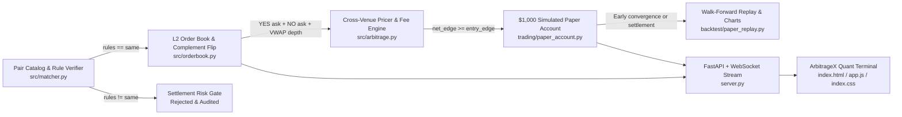
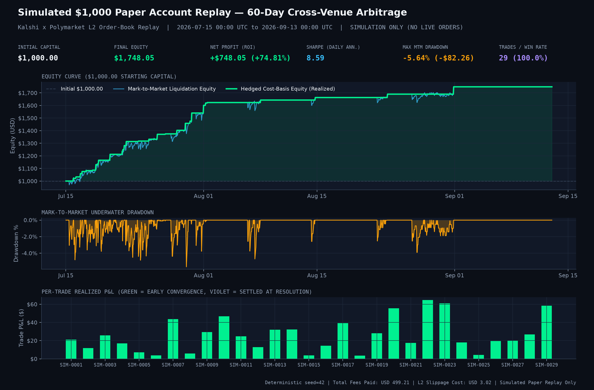
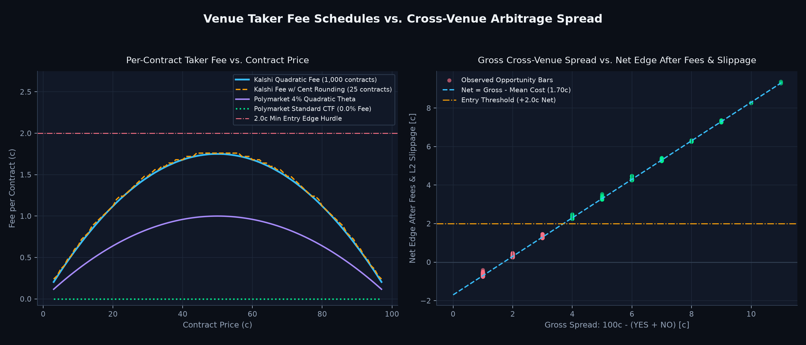
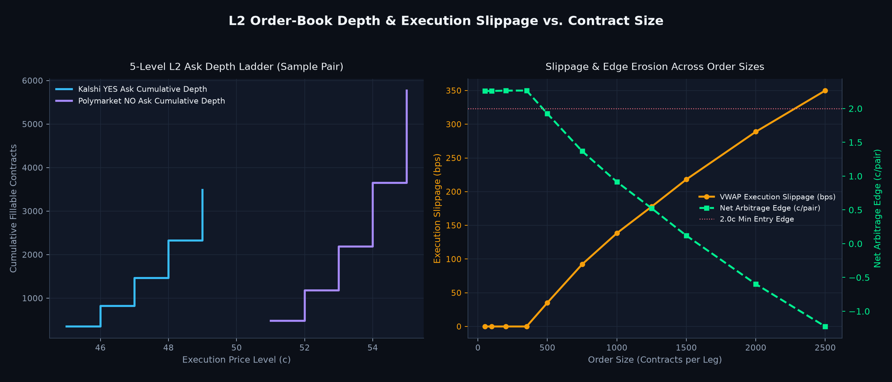
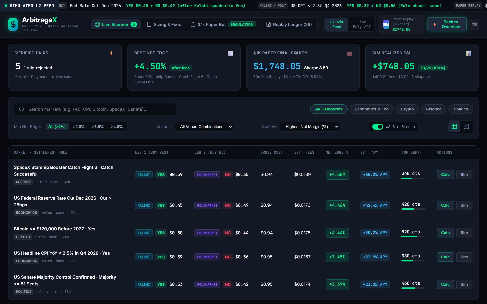
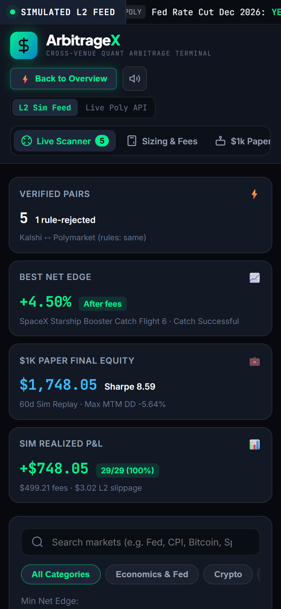

# ArbitrageX — Quantitative Cross-Venue Prediction Market Arbitrage Platform

[](LICENSE)
[](requirements.txt)
[](docs/PROOF_OF_WORK.md)
[](#deterministic-100000-simulated-paper-account-replay)

**ArbitrageX** is a quantitative cross-venue prediction market arbitrage research engine, multi-level L2 order-book slippage simulator, `$1,000.00` paper-account replay framework, and FastAPI/WebSocket web terminal operating across **Kalshi** and **Polymarket** binary event contracts.

> **Upstream Attribution (MIT):** Built directly atop the MIT-licensed [`Synpath-ai/prediction-market-arbitrage-trading-bot`](https://github.com/Synpath-ai/prediction-market-arbitrage-trading-bot) pricing core (`src/arbitrage.py`, `src/strategy.py`, `src/discover.py`, `backtest/`, `trading/`). See [`LICENSE`](LICENSE) and [`NOTICE.md`](NOTICE.md) for full upstream attribution.
>
> **Simulation & No-Live-Capital Disclaimer:** All replay performance metrics, equity curves, Sharpe ratios, and trade ledgers documented in this repository come from a **deterministic simulated paper-account replay** (`backtest/paper_replay.py`, `seed=42`) over synthetic L2 order books. **No real money was traded and no live venue orders were submitted.**

---

## Interactive Terminal Walkthrough


- **Full HD Walkthrough Video:** [`docs/proof/walkthrough.mp4`](docs/proof/walkthrough.mp4) · [`docs/proof/walkthrough.webm`](docs/proof/walkthrough.webm)
- **Desktop (`1440×900`) & Mobile (`390×844`) Captures:** [`dashboard-desktop.png`](docs/proof/dashboard-desktop.png) · [`dashboard-mobile.png`](docs/proof/dashboard-mobile.png)

---

## System Architecture



---

## Mathematical Formulation

### 1. Cross-Venue Binary Arbitrage Boundary

For a binary event contract paying `$1.00` upon `YES` and `$1.00` upon `NO` under **verified identical settlement rules** (`Pair.rules == "same"`), a cross-venue hedged portfolio purchases $C$ `YES` contracts on Venue $A$ and $C$ `NO` contracts on Venue $B$:

$$\text{Gross Cost}(C) = \text{VWAP}_{\text{YES}}^{(A)}(C) + \text{VWAP}_{\text{NO}}^{(B)}(C)$$

Because binary CLOBs quote `YES` depth, buying `NO` on Venue $B$ matches resting `YES` bids at complement price (`L2Book.no_asks`):

$$P_{\text{NO}}^{\text{ask}} = 1 - P_{\text{YES}}^{\text{bid}}$$

An actionable net arbitrage edge exists after venue fees $F_A, F_B$ if and only if:

$$\text{Net Edge per Pair} = 1.00 - \left(\text{VWAP}_{\text{YES}}^{(A)}(C) + \text{VWAP}_{\text{NO}}^{(B)}(C) + \frac{F_A(C) + F_B(C)}{C}\right) \ge \varepsilon_{\text{entry}}$$

### 2. Venue-Specific Taker Fee Nonlinearity

- **Kalshi (`quadratic`, `up_to_cent` rounding):**
  $$F_{\text{Kalshi}}(C, P) = \frac{\lceil 100 \cdot 0.07 \cdot C \cdot P(1 - P) \rceil}{100}$$
  Fee drag peaks at implied probability $P = 0.50$ (`$0.0175/contract` before cent rounding), requiring exact integer-lot evaluation rather than asymptotic linear approximations.
- **Polymarket (`quadratic_theta`):** Standard CTF order-book markets carry `taker_rate = 0.0` (with configurable `quadratic_theta` support via `synpath.FeeSchedule`).

### 3. L2 VWAP Slippage & Depth Constraint

Walking cumulative ask tiers $\{(p_i, q_i)\}_{i=1}^{L}$ for order size $C \le \sum_i q_i$:

$$\text{VWAP}(C) = \frac{1}{C} \sum_{i=1}^{L} \tilde{q}_i p_i, \qquad \text{Slippage per Contract} = \text{VWAP}(C) - p_1$$

where $\tilde{q}_i = \min\big(q_i,\; C - \sum_{j < i} \tilde{q}_j\big)$. Orders whose size exceeds fillable L2 depth or whose slippage compresses $\text{Net Edge}$ below $\varepsilon_{\text{entry}}$ are rejected or downsized automatically.

### 4. Early Spread Convergence & Risk-Adjusted Metrics

Rather than locking capital until contract maturity, `PaperAccount` (`trading/paper_account.py`) monitors exit bids across both legs (`L2Book.no_bids`) and unwinds whenever round-trip net proceeds clear `take_profit`:

$$\left(\text{Bid}_{\text{YES}}^{(A)} + \text{Bid}_{\text{NO}}^{(B)} - \frac{F_{\text{exit}}}{C}\right) - \text{Entry Cost per Pair} \ge \text{take\_profit}$$

Daily mark-to-market equity $E_d$ yields daily simple returns $r_d = E_d / E_{d-1} - 1$ and annualized Sharpe ratio $\text{Sharpe} = \sqrt{252} \cdot \bar{r}_d / \sigma(r_d)$.

---

## Deterministic `$1,000.00` Simulated Paper Account Replay

Running `python -m backtest.paper_replay` executes a deterministic 60-day (`1,440`-hour, `2026-07-15` to `2026-09-13 UTC`, `seed=42`) simulated L2 walk-forward across **6 cross-venue pairs** (`5` rule-compatible pairs + `1` `not_same` TikTok pair explicitly rejected by `verify_rule_compatibility`), enforcing a `45%` max allocation per position and `4` max simultaneous positions.

| Simulated Replay Metric | Observed Value |
| :--- | :--- |
| **Execution Mode** | **Simulated Paper Account Replay (Zero Live Orders)** |
| **Initial Capital** | `$1,000.00` |
| **Final Equity** | `$1,748.05` |
| **Realized P&L / ROI** | `+$748.05` (`+74.81%`) |
| **Executed Round-Trips** | `29` (`29 won` / `0 lost` / `100.0%` win rate) |
| **Exit Breakdown** | `29` early convergence exits · `0` held to resolution |
| **Daily Annualized Sharpe** | `8.59` |
| **Max Mark-to-Market Drawdown** | `-5.64%` (`-$82.26`) |
| **Total Taker Fees Paid** | `$499.21` |
| **Total L2 Slippage Cost** | `$3.02` |
| **Average Locked Edge / Pair** | `$0.033` (`3.3¢` per `$1.00` pair) |
| **Rule-Rejected Pairs** | `1` (`kalshi:TIKTOK-BAN26`, `rules="not_same"`) |

### Quantitative Proof Charts

| `$1,000` Paper Equity & Drawdown | Gross vs. Net Spread After Fees | L2 Depth & Execution Slippage |
| :---: | :---: | :---: |
|  |  |  |

---

## Responsive Quant Terminal UI (`1440×900` & `390×844`)

| Desktop Scanner (`1440×900`) | Mobile Viewport (`390×844`) |
| :---: | :---: |
|  |  |

---

## Tools, Skills, AI & Quant Stack

- **Quantitative Pricing & Market Microstructure:** Python `3.12+`, `synpath==0.11.0` (`FeeSchedule`, market discovery & venue normalization), custom 5-level L2 order-book VWAP & complement-flip engine (`src/orderbook.py`), quadratic cent-rounding fee model (`src/arbitrage.py`), settlement-rule gate (`src/matcher.py`), stateful `$1,000` paper-account ledger (`trading/paper_account.py`).
- **Simulation, Analytics & Visualization:** NumPy, Matplotlib (dark-theme quantitative equity, fee-frontier, and L2 slippage figures in `backtest/paper_replay.py`), deterministic PRNG walk-forward (`seed=42`).
- **Backend & Real-Time Streaming:** FastAPI, Uvicorn, Pydantic v2, native WebSockets (`/ws/stream`), REST endpoints for L2 depth curves, live Polymarket Gamma public API proxy, exact fee/sizing calculation, and paper-bot execution.
- **Frontend Terminal:** Vanilla ES6+, responsive dark-mode CSS grid/flexbox (`390×844` mobile & `1440×900` desktop verified), live WebSocket tick highlighting, L2 book modal, sizing & payoff matrix calculator, and full 29-trade replay ledger CSV export.
- **Verification & Visual Proof Tooling:** `pytest` (`28 passed`), FastAPI `TestClient` + WebSocket tests, Playwright headless Chromium automation (console/page-error & mobile horizontal-overflow assertions), and FFmpeg (`libx264` MP4 + 2-pass palette GIF).

---

## Quickstart & Verification

### 1. Install Dependencies

```bash
python -m pip install -r requirements.txt
```

*(Optional)* Copy `.env.example` to `.env` if connecting to live authenticated feeds via `SYNPATH_API_KEY`. The server, backtest replay, and L2 WebSocket simulation mode run **100% offline with no API keys required**.

### 2. Run the Deterministic `$1,000` Paper Replay & Generate Charts

```bash
python -m backtest.paper_replay
```

Generates `out/paper_replay_1000.json` and updates the three quantitative figures in `docs/proof/`.

### 3. Launch the FastAPI Quant Terminal & WebSocket Server

```bash
python server.py
# or: uvicorn server:app --host 127.0.0.1 --port 8080
```

Open `http://127.0.0.1:8080/` (or `http://127.0.0.1:8080/?view=terminal&tab=scanner`).

### 4. Run the Full Test Suite

```bash
python -m pytest -v
```

---

## Documentation & Verification Artifacts

- [`docs/CASE_STUDY.md`](docs/CASE_STUDY.md) — Engineering & microstructure deep dive (settlement risk, fee nonlinearity, L2 depth sizing, early convergence).
- [`docs/PROOF_OF_WORK.md`](docs/PROOF_OF_WORK.md) — Verifiable command outputs, 28-test inventory, file artifacts, and exact observed `$1,000` replay numbers.
- [`NOTICE.md`](NOTICE.md) — Upstream attribution and modification summary for [`Synpath-ai/prediction-market-arbitrage-trading-bot`](https://github.com/Synpath-ai/prediction-market-arbitrage-trading-bot).
- [`LICENSE`](LICENSE) — MIT License.
