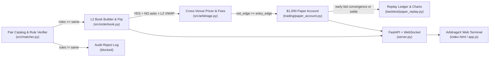

# Cross-Venue Prediction Market Arbitrage: L2 Microstructure, Fee Nonlinearity, and $1,000 Simulated Paper Replay Case Study

> **Simulation Disclaimer:** All execution metrics, equity curves, and trade records analyzed in this case study are generated by a **deterministic simulated paper-account replay** (`backtest/paper_replay.py`, `seed=42`) over synthetic Kalshi and Polymarket L2 order books. **No real capital was deployed and no live orders were submitted.**

---

## 1. Executive Summary

Binary event contracts traded across distinct prediction venues—regulated US designated contract markets (Kalshi) and decentralized Central Limit Order Book / CTF exchanges (Polymarket)—frequently exhibit transient cross-venue implied-probability dispersion. When the sum of opposing complementary contract asks (`YES` on Venue A + `NO` on Venue B) falls strictly below the guaranteed `$1.00` settlement payout minus venue taker fees and L2 order-book impact, a hedged arbitrage portfolio is available.

This case study documents the engineering upgrades made atop the MIT-licensed [`Synpath-ai/prediction-market-arbitrage-trading-bot`](https://github.com/Synpath-ai/prediction-market-arbitrage-trading-bot) base engine to build **ArbitrageX**:

1. **Settlement Rule Compatibility Gate (`src/matcher.py`)**: Enforces `verify_rule_compatibility` before pricing or execution, explicitly rejecting `not_same` or unverified pairs (demonstrated by rejecting `kalshi:TIKTOK-BAN26` despite surface-level event similarity).
2. **Multi-Level L2 VWAP Depth & Slippage Engine (`src/orderbook.py`)**: Replaces top-of-book scalar assumptions with deterministic 5-level bid/ask ladders (`L2Book`, `simulate_buy`, `simulate_cross_venue_pair`) capturing partial-fill boundaries, `no_asks = 1 - yes_bids`, and exact fee integration.
3. **Venue-Specific Quadratic Fee Modeling (`src/arbitrage.py`, `src/orderbook.py`)**: Models Kalshi's non-linear cent-rounded quadratic taker fee $\text{ceil}_{0.01}(0.07 \cdot C \cdot P(1-P))$ versus Polymarket's 0% standard CTF taker schedule.
4. **$1,000.00 Simulated Paper Account & Early Convergence Exit (`trading/paper_account.py`, `backtest/paper_replay.py`)**: Tracks cash, locked collateral, per-position risk caps (45% max per position, 4 max simultaneous positions), early convergence unwind when opposing bids exceed entry cost plus `take_profit`, and daily annualized Sharpe ratio.

Over a deterministic 60-day (`1,440`-hour) simulated walk-forward replay initialized with `$1,000.00`:

| Observed Replay Metric | Value (Simulated Paper Replay) |
| :--- | :--- |
| **Initial Capital** | `$1,000.00` |
| **Final Equity** | `$1,748.05` |
| **Realized P&L / ROI** | `+$748.05` (`+74.81%`) |
| **Completed Trades** | `29` (`29 won`, `0 lost`, `100.0%` win rate) |
| **Exit Attribution** | `29` early convergence unwinds / `0` held to resolution |
| **Daily Annualized Sharpe** | `8.59` |
| **Max MTM Drawdown** | `-5.64%` (`-$82.26`) |
| **Total Venue Fees Paid** | `$499.21` |
| **Total L2 Slippage Cost** | `$3.02` |
| **Avg Locked Net Edge / Pair** | `$0.033` (`3.3¢` per `$1.00` pair) |
| **Rule-Rejected Pairs** | `1` (`kalshi:TIKTOK-BAN26`, `rules="not_same"`) |

---

## 2. Structural & Microstructure Challenges Solved

### 2.1 Settlement Basis Risk (Rule Mismatch Trap)

Surface-level arbitrage scanners often pair two contracts that reference the same headline topic while differing on oracle source, deadline timezone, or legal threshold. If an arbitrageur holds `YES` on Kalshi and `NO` on Polymarket under divergent rules, a joint tail outcome can cause **both legs to settle at `$0.00`**—converting an apparent `3%` locked spread into a `-100%` principal wipeout.

In `src/matcher.py`, `verify_rule_compatibility(pair, require_same_rules=True)` parses `Pair.rules` and `Pair.rules_reason` into an explicit `RuleAudit` verdict before any order-book pricing is permitted:

- `rules="same"` → `accepted=True`
- `rules="not_same"` or `"unknown"` → `accepted=False`, logged and blocked from paper execution.

In the `DEFAULT_UNIVERSE`, `kalshi:TIKTOK-BAN26` (*"ByteDance divestiture deadline vs court stay vs executive order enforcement criteria diverge"*) is explicitly paired with `rules="not_same"` so every run verifies the rule gate rejects it cleanly.

### 2.2 Fee Nonlinearity & Cent Rounding at $P \approx 0.50$

Kalshi's standard quadratic fee schedule peaks at fair-value $P = 0.50$:

$$F_{\text{Kalshi}}(C, P) = \frac{\lceil 100 \cdot 0.07 \cdot C \cdot P(1 - P) \rceil}{100}$$

At $P = 0.50$ and $C = 1,000$ contracts:
- Unrounded fee: $0.07 \times 1000 \times 0.25 = \$17.50$ (`$0.0175/pair`)
- Contrast with extreme probability $P = 0.10$: $0.07 \times 1000 \times 0.09 = \$6.30$ (`$0.0063/pair`)

Crucially, **ceiling rounding up to the nearest cent** penalizes micro-lots disproportionately (`C = 1` contract at `$0.50` rounds `$0.0175` up to `$0.02`, or `2.0¢` per contract!). Sizing models must evaluate fees at actual integer contract size $C$ rather than assuming asymptotic per-contract fee rates.

### 2.3 Synthetic NO Liquidity & L2 Depth Impact

Prediction market order books are commonly published in `YES` coordinates:
- Buying `YES` walks the `YES` ask ladder (`asks`).
- Buying `NO` on a binary CLOB matches against resting `YES` bids at complement price:
  $$P_{\text{NO}}^{\text{ask}} = 1 - P_{\text{YES}}^{\text{bid}}$$
  implemented directly in `L2Book.no_asks` and `L2Book.no_bids`.

When `Pricer.price()` evaluates only top-of-book liquidity, a `4¢` gross edge can vanish or turn negative if an order consumes 3–4 depth tiers. `L2Book.simulate_buy()` walks cumulative levels, computes exact volume-weighted average price (`vwap_price`), decomposes `slippage_per_contract = vwap_price - top_price`, and rejects pairs whenever available cross-venue depth falls short or net edge drops below `entry_edge`.

### 2.4 Early Convergence vs. Hold-to-Resolution Capital Velocity

Holding a locked `$0.03` edge to a 45-day resolution ties up `$0.953` of collateral for `$0.03` profit (~`25.5%` annualized). However, cross-venue pricing anomalies are typically **mean-reverting shocks**: once liquidity providers rebalance quotes across Kalshi and Polymarket within hours, the combined bid for the held `(YES, NO)` pair exceeds entry cost plus `take_profit`:

$$\text{bid}_{\text{YES}}^{(\text{V}_1)} + \text{bid}_{\text{NO}}^{(\text{V}_2)} - F_{\text{exit}} - \text{entry\_cost} \ge \text{take\_profit}$$

In the 60-day `$1,000` simulated paper replay (`entry_edge = 0.02`, `take_profit = 0.02`), **all 29 trades (`29 / 29`) exited via early spread convergence** rather than waiting weeks for event settlement. That capital velocity unlocked compound reinvestment under the 45% per-position allocation cap, growing `$1,000.00` to `$1,748.05` across 29 round-trips while keeping total L2 slippage to `$3.02`.

---

## 3. Architecture & Production Hardening Summary

Key engineering fixes applied during hardening:
- **Windows asyncio Compatibility (`trading/__main__.py`)**: Wrapped `loop.add_signal_handler` with a `NotImplementedError` fallback using `signal.signal` so live/paper runners terminate cleanly on Windows event loops.
- **FastAPI + WebSocket Streaming (`server.py`)**: Replaced simple static serving with typed FastAPI endpoints (`/api/health`, `/api/markets`, `/api/orderbook/{market_id}`, `/api/paper-account`, `/api/calculate`, `/api/bot/*`) and live simulated WebSocket ticks (`/ws/stream`).
- **Automated Verification (`tests/`)**: Expanded from 14 base tests to **28 `pytest` assertions** covering L2 slippage curves, complement `no_asks` flips, Kalshi fee rounding, rule rejection, `$1,000` paper cash/equity invariants, and HTTP endpoint contracts.

---

## 4. Risk Caveats & Next Research Steps

1. **Legging / Partial-Fill Asymmetry**: In live execution without atomic cross-venue clearing, one leg can fill while the second leg moves before acknowledgement. Future work should model stochastic latency (`50–250ms` Polymarket polygon/CLOB vs Kalshi REST/FIX) and dynamic hedge-unwind penalties.
2. **Inventory & Fee Tier Calibration**: Kalshi volume rebates, Polymarket maker rebates, and non-zero Polymarket `quadratic_theta` markets (`crypto`/short-duration) shift the optimal `entry_edge` boundary dynamically.
3. **Semantic Rule NLP Monitoring**: Extending `verify_rule_compatibility` with automated LLM/AST diffing on live venue rule PDFs reduces manual `rules="same"` curation risk.
